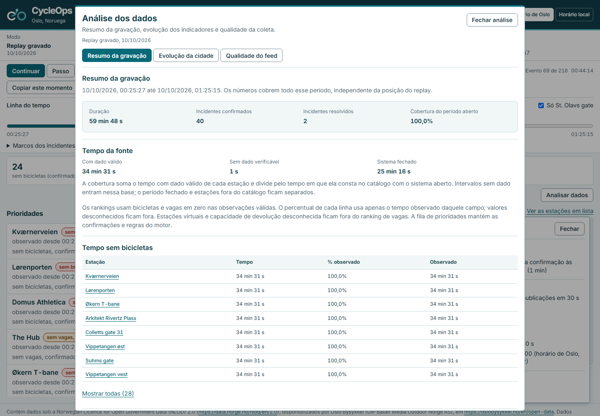
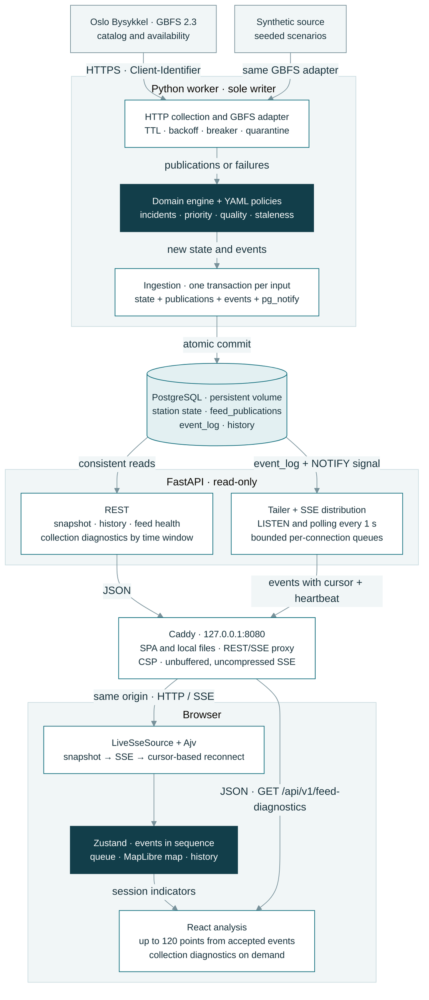
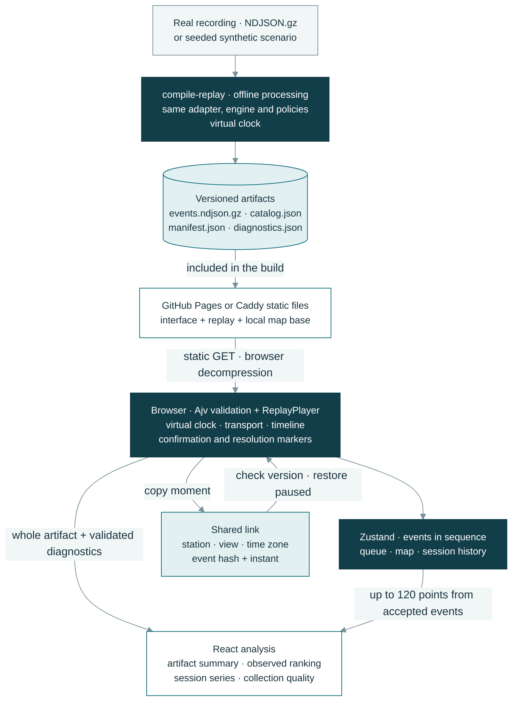

# CycleOps

<picture>
  <source media="(prefers-color-scheme: dark)" srcset="docs/brand/cycleops-lockup-light.svg">
  
</picture>

Oslo Bysykkel stations with no bikes or no free docks, ordered by priority, with the reason and the data behind each decision. Open GBFS data, an Oslo map and a replay of a real recording.

[Leia em português](README.md)

[](https://github.com/arthurjoanes/cycleops/actions/workflows/ci.yml)

<p>
  <a href="#demo"></a>
  <a href="#architecture"></a>
  <a href="#run-locally"></a>
  <a href="#tests-and-results"></a>
  <a href="https://www.linkedin.com/in/arthur-joanes-6a2967373/"></a>
</p>

## Overview

CycleOps orders Oslo Bysykkel stations that have no bikes or no physical docks available. Someone monitoring availability can open an incident, check the counts and see why it occupies that position in the queue.

The engine confirms shortages across feed publications and tracks their resolution. Connection failure, stale data and overnight closure have separate states in the interface. The [policy](policy/priority-policy.yaml) defines the criteria; the [Python engine](apps/backend/src/cycleops/domain/engine.py) applies the same rules to live data, recordings and simulation.

This is a portfolio project using open data. The public demo uses a real recording; live collection runs in local Compose.

| Mode | How it runs |
|---|---|
| Recorded replay | A real feed recording is processed offline and played in the browser. This is the initial mode in the Pages build. |
| Simulation | Seeded stations and counts, always labelled “Simulação”. Compose uses the worker and API; the browser replay uses an artifact. |
| Live | The worker polls Oslo at the feed's TTL cadence and sends events through the API. Local Compose only. |

## Demo

[Open the demo](https://arthurjoanes.github.io/cycleops/) · Recorded replay, no login.


Captured on 2026-10-09 (UTC) with Playwright against the Pages build, replaying recorded real data. Its period and timestamps belong to the recording. [Mobile view](docs/media/identity-mobile.png) · [Recording and acceptance](docs/results/feed-validation.md).

Choose a time on the timeline or use “Ir para o incidente”. Markers show confirmation and resolution; opening a station lets you filter its markers. “Copiar este momento” creates a link that opens the same station and time with playback paused.

In “Analisar dados”, the summary shows observed time without bikes or docks per station and resolved incidents. “Evolução da cidade” tracks indicators from accepted events in this session; “Qualidade do feed” explains HTTP responses and accepted or repeated publications.



[Collection quality](docs/media/analysis-quality.png) · [Analysis on mobile](docs/media/analysis-mobile.png) · [How to explore the data](docs/explorar-dados.md).

The engine produced these events from the recording made on 2026-10-09. Links open the recorded instants in Oslo time:

| Station and condition | Confirmation | Resolution |
|---|---|---|
| St. Olavs gate (537), no docks | [Event 69 · 00:44:14](https://arthurjoanes.github.io/cycleops/#/?mode=recorded&station=537&artifact=48e2c7d55854510f1845b9ef2950aa0274a7c0f4363f090a71032f3b0eed0031&at=1126.445) | [Event 95 · 00:51:29](https://arthurjoanes.github.io/cycleops/#/?mode=recorded&station=537&artifact=48e2c7d55854510f1845b9ef2950aa0274a7c0f4363f090a71032f3b0eed0031&at=1561.645) |
| Jakob kirke (412), no bikes | [Event 106 · 00:54:29](https://arthurjoanes.github.io/cycleops/#/?mode=recorded&station=412&artifact=48e2c7d55854510f1845b9ef2950aa0274a7c0f4363f090a71032f3b0eed0031&at=1741.76) | [Event 124 · 00:59:29](https://arthurjoanes.github.io/cycleops/#/?mode=recorded&station=412&artifact=48e2c7d55854510f1845b9ef2950aa0274a7c0f4363f090a71032f3b0eed0031&at=2041.909) |

The [replay manifest](apps/web/public/replay/recorded/manifest.json) records these points and the file hashes; [feed validation](docs/results/feed-validation.md) describes the recording window and its limits. The [demo video](docs/media/identity-demo.webm) follows Jakob kirke from confirmation to resolution at 20×.

## Architecture

The backend is a modular monolith with two processes: the worker computes and persists decisions; the API delivers state and events to the browser. Both execution paths share the same Python domain engine.

### Compose runtime

Arrows show the direction of data flow. The worker uses either the real or synthetic source, depending on configuration; Caddy is the only published port.



- The engine takes state, input and policy and returns state and events. It has no network, database or system-clock access.
- State and events share one commit. `pg_notify` only wakes the tailer; events are read from `event_log`, including after a missed notification.
- The API uses short database sessions. Each SSE connection has a bounded queue and resumes from its cursor; when that cursor cannot be recovered, the browser fetches a new snapshot.
- The interface validates contracts and applies events in order. Incident and priority decisions come from the engine.

### Replay published on GitHub Pages

Processing happens before the build. The public demo plays precomputed events without an API, database or requests to Oslo's feed. Compose also offers these files as a replay option.



Pydantic contracts generate JSON Schema and TypeScript types; Ajv validates responses and artifacts in the browser. Generated data carries policy and version metadata.

The summary uses events from the entire recording. Rankings count only observed intervals with valid data; gaps and service closure appear separately. Diagnostics accompany the artifact in `diagnostics.json` and come from a REST query in stream mode. City trends keep up to 120 points from accepted events; a replay jump rebuilds the latest points up to the selected instant.

[Transaction, SSE delivery and recovery sequence](docs/architecture.md#da-entrada-ao-navegador) · [Processes, connections and tests](docs/architecture.md) · [Architecture decisions](docs/adr/). Detailed documents are in Portuguese.

| Responsibility | Implementation |
|---|---|
| Collect and normalize | [Collector](apps/backend/src/cycleops/collection/collector.py) and [GBFS adapter](apps/backend/src/cycleops/adapters/gbfs.py): cadence, failures and normalized data. |
| Decide and persist | [Engine](apps/backend/src/cycleops/domain/engine.py) and [ingestion](apps/backend/src/cycleops/application/ingest.py): incidents, priority and one commit for state and events. |
| Deliver and recover | [Tailer](apps/backend/src/cycleops/api/tailer.py) and [SSE stream](apps/backend/src/cycleops/api/stream.py): log reads, per-connection queues and cursor recovery. |
| Replay and display | [Compiler](apps/backend/src/cycleops/application/replay.py), [data session](apps/web/src/app/useDataSession.ts) and [store](apps/web/src/features/stations/store.ts): live and replay feed the same components. |
| Explore and diagnose | [Browser analysis](apps/web/src/features/analysis/), [replay link](apps/web/src/features/replay/replayMoment.ts) and [collection report](apps/backend/src/cycleops/application/feed_diagnostics.py): summary, indicators and reasons per attempt. |

## Stack and decisions

<a id="stack"></a>

<p>
  
  
  
  
  
  
</p>

| Choice | Reason and trade-off |
|---|---|
| Python + Pydantic + FastAPI | The same engine processes live data and replay, with contracts generated for the web. Domain changes require regenerating artifacts. |
| PostgreSQL + SSE | State and events share a transaction; the browser receives updates through a one-way stream. The tailer polls the database every second, and each tab keeps an SSE connection. |
| React + TypeScript + Zustand | The store applies events in sequence and shares state across the queue, map and details. Sequence gaps require event recovery or a fresh snapshot. |
| MapLibre + local OpenStreetMap base | The map uses files served alongside the interface. The base is simplified and must be regenerated to incorporate geographic changes. |
| Vite + GitHub Pages | The public demo plays a recording without an active backend. New recorded data requires compiling and publishing artifacts. |
| Docker Compose + Caddy | Packages the database, worker, API and web for local installation. Services share the same host. |

[Event delivery alternatives](docs/adr/0003-entrega-de-eventos-sem-broker.md#alternativas) · [Replay choices](docs/adr/0004-replay-no-navegador.md#alternativas) · [State and rendering](docs/adr/0005-estado-e-renderizacao.md) · [Exploration and diagnostics](docs/adr/0006-exploracao-e-diagnostico.md).

Pinned dependencies: [Python](apps/backend/uv.lock), [web](apps/web/pnpm-lock.yaml) and [Compose images](compose.yaml).

## Run locally

Use Docker with Linux containers and Docker Compose. From the repository root:

```bash
docker compose up --build
```

Open [127.0.0.1:8080](http://127.0.0.1:8080). Compose starts in simulation mode. PostgreSQL has no published port; the default passwords are for local use only. See [.env.example](.env.example) to override them.

For the real Oslo feed, copy [.env.live.example](.env.live.example) to `.env.live`, set `CYCLEOPS_CLIENT_IDENTIFIER` as `<organization>-<application>` and use a separate project:

```bash
docker compose -p cycleops-live --env-file .env.live up --build
```

Only one stack publishes port 8080 at a time. Stop the previous one before switching: `docker compose down` for simulation or `docker compose -p cycleops-live down` for live. Use `--build` after changing the code.

The standalone replay needs Node 24 with corepack:

```bash
cd apps/web
corepack pnpm install
corepack pnpm build:pages
corepack pnpm preview:pages
```

Open [127.0.0.1:4173/cycleops/](http://127.0.0.1:4173/cycleops/). For development, `corepack pnpm dev` opens [localhost:5173](http://localhost:5173) and tries the Compose stream first; without the stack it offers the file replay.

## Tests and results

The script needs Bash (Git Bash or WSL on Windows), Docker, git, uv, Node 24 with corepack and Playwright's Chromium. It runs the local equivalents of CI checks, except gitleaks:

```bash
scripts/checks
```

For the web app, from `apps/web`:

```bash
corepack pnpm lint
corepack pnpm typecheck
corepack pnpm test
corepack pnpm exec playwright install chromium
corepack pnpm e2e
corepack pnpm check:bundle
```

The `e2e` command builds Pages under `/cycleops/` and starts its own server on port 4188. It does not reuse an existing server; `CYCLEOPS_WEB_TEST_PORT` selects another port. Manual preview stays on port 4173. `check:bundle` checks the generated build. Backend and Compose E2E commands are in [CONTRIBUTING.md](CONTRIBUTING.md). The `e2e:compose` suite uses the isolated `cycleops-e2e` project and deletes its database in the last test.

| Question | Record and result | Scope |
|---|---|---|
| Did the backend and browser tests pass? | [Publication CI](docs/results/publicacao.md), 2026-10-09 in Brasília time, commit `185e5af`: 354 Python tests, 69 web unit tests, 14 Pages E2E and 11 Compose E2E. | The run identifies the tested revision; the Compose job uses the synthetic source without internet access. |
| Does the recording contain resolved incidents? | [Real collection](docs/results/feed-validation.md), 2026-10-09: 249 responses over 60 min, all HTTP 200; 218 events and two resolved incidents in the replay. | The window includes overnight closure and does not represent daytime activity. |
| How can I check what reached the engine? | [Exploration report](docs/results/exploracao-20261011.md): the recording contains 225 accepted publications and 24 repeated publications, with 40 confirmed incidents and two resolved. | HTTP responses, accepted publications and engine events have distinct counts. |
| Does the published demo open on desktop and mobile? | [Public URL check](docs/results/data/public-pages-20261010.json), 2026-10-09 at 21:08 Brasília time: pause, incident jump and map at 1440×900 and 320×900. | No overflow or errors in this walkthrough; manual accessibility review is still pending. |
| How did the interface behave in the lab? | [Visual review](docs/results/identity-20261009.md), 2026-10-09: 119,270-byte gzip bundle; median LCP 3,248 ms, CLS 0.004 and INP 240 ms across three runs. | Chromium with emulated CPU and network conditions; these are not real-user metrics. |

The [results index](docs/results/index.md) lists commands, commits and dates. [Replay and Compose validation](docs/results/validacao-20261009.md) covers persistence and reconnection; the [performance report](docs/results/performance.md) retains load and latency scenarios. Additional daytime samples and the [manual accessibility checklist](docs/results/a11y-manual.md) remain pending.

## Limitations and security

- Independent project, unaffiliated with Oslo Bysykkel. Read-only, with no booking or dispatch.
- The feed has no SLA. Live runs only in local Compose; collection and freshness criteria are in the [provider policy](policy/provider-oslo.yaml) and [priority policy](policy/priority-policy.yaml).
- The simplified map base is not for navigation.
- Rankings use only the recording window and observed counts. They do not estimate trips or weekly patterns; city trends cover up to 120 points from accepted events in the session or reconstructed replay prefix.
- Each Compose browser tab uses one SSE connection. The API allows four per IP and closes the oldest when a fifth opens. [Limits and recovery](docs/architecture.md#ligações).
- Pages delivers CSP through a meta tag, with fewer controls than Caddy's header. See [SECURITY.md](SECURITY.md) for controls and retention.

## Documentation

| Topic | Document |
|---|---|
| Sources, licensing and collection | [Data sources](DATA_SOURCES.md) · [Feed validation](docs/results/feed-validation.md) |
| Implementation and decisions | [Architecture](docs/architecture.md) · [ADRs](docs/adr/) · [Commands](CONTRIBUTING.md) |
| Replay, indicators and quality | [Explore the data](docs/explorar-dados.md) · [Exploration validation](docs/results/exploracao-20261011.md) |
| Runs and measurements | [Results](docs/results/index.md) · [Performance](docs/results/performance.md) |
| Publication and manual review | [Publication checklist](docs/results/publicacao.md) · [Accessibility](docs/results/a11y-manual.md) |
| Presentation | [Visual identity](docs/brand/README.md) · [Documentation pattern](docs/padrao-documentacao.md) |

## Author and license

Developed by Arthur Joanes. Get in touch to discuss open data, event delivery and station operations:

<p>
  <a href="https://www.linkedin.com/in/arthur-joanes-6a2967373/">
    
    <strong>Arthur Joanes on LinkedIn</strong>
  </a>
</p>

Code under the [MIT license](LICENSE). Oslo Bysykkel data under NLOD 2.0 and the OpenStreetMap base under ODbL: [sources and attribution](DATA_SOURCES.md). Libraries and other licenses are listed in [THIRD_PARTY_NOTICES.md](THIRD_PARTY_NOTICES.md).

Stack and LinkedIn icons: [Devicon, MIT license](docs/stack/LICENSE.devicon).
