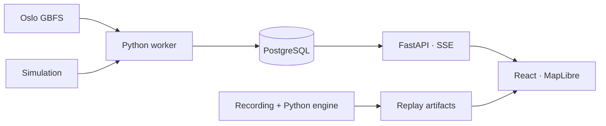

# CycleOps

<picture>
  <source media="(prefers-color-scheme: dark)" srcset="docs/brand/cycleops-lockup-light.svg">
  
</picture>

Oslo Bysykkel stations with no bikes or no free docks, ordered by priority, with the reason and the data behind each decision. Open GBFS data, an Oslo map and a replay of a real recording.

[Leia em português](README.md)

<p>
  <a href="#demo"></a>
  <a href="#architecture"></a>
  <a href="#run-locally"></a>
  <a href="#tests-and-results"></a>
  <a href="https://www.linkedin.com/in/arthur-joanes-6a2967373/"></a>
</p>

## Overview

CycleOps tracks stations with no bikes or no physical docks. The engine confirms incidents across feed publications, orders the queue and tracks recovery. Each row explains the decision; station details show counts, timestamps and history.

The same Python engine processes live data, recordings and simulation. The interface keeps the mode visible, distinguishes a connection failure from stale data and shows the service's overnight closure.

| Mode | How it runs |
|---|---|
| Recorded replay | A real feed recording is processed offline and played in the browser. This is the initial mode in the Pages build. |
| Simulation | Seeded stations and counts, always labelled “Simulação”. Compose uses the worker and API; the browser replay uses an artifact. |
| Live | The worker polls Oslo at the feed's TTL cadence and sends events through the API. Local Compose only. |

## Demo


Captured on 2026-10-09 (UTC) with Playwright against the Pages build, replaying recorded real data. Its period and timestamps belong to the recording. [Mobile view](docs/media/identity-mobile.png) · [Recording and acceptance](docs/results/feed-validation.md).

Pause, choose 5× or 20×, advance with “Passo” or jump with “Ir para o incidente”. In the recording, St. Olavs gate runs out of docks; the incident is confirmed and later resolved. Simulation remains available in the mode selector.

The [27 s video of the earlier version](docs/media/demo.webm) shows simulation in Compose, a confirmed incident, reconnection after an API restart and switching to the file replay. It retains the interface's previous appearance.

## Architecture



In Compose, the worker is the only writer. PostgreSQL stores state and events, the API is read-only, and Caddy serves the interface and proxies the API. The Pages build plays the artifacts in the browser.

[Processes, connections and tests](docs/architecture.md) · [Architecture decisions](docs/adr/). Detailed documents are in Portuguese.

## Stack and decisions

| Part | Choice |
|---|---|
| Interface | React, TypeScript, Vite and Zustand. The interface applies events and displays engine decisions. |
| Map and history | MapLibre with a local OpenStreetMap base; an SVG step chart with a table alternative. |
| Engine and API | Python, Pydantic and FastAPI. Live and replay share the incident rules. |
| Events and runtime | PostgreSQL, SSE, Docker Compose and Caddy. PostgreSQL also signals new events. |

## Run locally

Docker is the only requirement for the full application. From the repository root:

```bash
docker compose up --build
```

Open [127.0.0.1:8080](http://127.0.0.1:8080). Compose starts in simulation mode. PostgreSQL has no published port; the default passwords are for local use only. See [.env.example](.env.example) to override them.

For the real Oslo feed, copy [.env.live.example](.env.live.example) to `.env.live`, set `CYCLEOPS_CLIENT_IDENTIFIER` as `<organization>-<application>` and use a separate project:

```bash
docker compose -p cycleops-live --env-file .env.live up --build
```

Only one stack publishes port 8080 at a time. Stop the previous one before switching: `docker compose down` for simulation or `docker compose -p cycleops-live down` for live. Use `--build` after changing the code.

The standalone replay needs Node 24 with corepack:

```bash
cd apps/web
corepack pnpm install
corepack pnpm build:pages
corepack pnpm preview:pages
```

Open [127.0.0.1:4173/cycleops/](http://127.0.0.1:4173/cycleops/). For development, `corepack pnpm dev` opens [localhost:5173](http://localhost:5173) and tries the Compose stream first; without the stack it offers the file replay.

## Tests and results

The script needs Bash, Docker, git, uv, Node 24 with corepack and Playwright's Chromium. It runs the local equivalents of CI checks, except gitleaks:

```bash
scripts/checks
```

For the web app, from `apps/web`:

```bash
corepack pnpm lint
corepack pnpm typecheck
corepack pnpm test
corepack pnpm exec playwright install chromium
corepack pnpm e2e
corepack pnpm check:bundle
```

The `e2e` command builds Pages under `/cycleops/`; `check:bundle` checks that build. Backend and Compose E2E commands are in [CONTRIBUTING.md](CONTRIBUTING.md). The `e2e:compose` suite uses the isolated `cycleops-e2e` project and deletes its database in the last test.

| Record | Result |
|---|---|
| [Real feed collection](docs/results/feed-validation.md) | 249 responses over 60 min, all HTTP 200. The replay contains 218 events and two resolved incidents. |
| [Replay and Compose checks](docs/results/validacao-20261009.md) | Engine, persistence, SSE, reconnection and browser tests, with commands and recorded results. |
| [Performance](docs/results/performance.md) | Frontend load, lab Web Vitals and Compose latency, with the environment and data for each run. |

The [results index](docs/results/index.md) links runs to commands, commits and dates. Additional daytime samples and the [manual accessibility checklist](docs/results/a11y-manual.md) remain pending.

## Limitations and security

- Independent project, unaffiliated with Oslo Bysykkel. Read-only, with no booking or dispatch.
- The feed has no SLA. Live runs only in local Compose.
- The simplified map base is not for navigation.
- Each Compose browser tab uses one SSE connection. The API allows four per IP and closes the oldest when a fifth opens.
- Pages delivers CSP through a meta tag, with fewer controls than Caddy's header. See [SECURITY.md](SECURITY.md) for controls and retention.

## Documentation

| Topic | Document |
|---|---|
| Sources, licensing and collection | [Data sources](DATA_SOURCES.md) · [Feed validation](docs/results/feed-validation.md) |
| Implementation and decisions | [Architecture](docs/architecture.md) · [ADRs](docs/adr/) · [Commands](CONTRIBUTING.md) |
| Runs and measurements | [Results](docs/results/index.md) · [Performance](docs/results/performance.md) |
| Publication and manual review | [Publication checklist](docs/results/publicacao.md) · [Accessibility](docs/results/a11y-manual.md) |
| Brand and colors | [Visual identity](docs/brand/README.md) |

## Author and license

Developed by Arthur Joanes. [LinkedIn](https://www.linkedin.com/in/arthur-joanes-6a2967373/).

Code under the [MIT license](LICENSE). Oslo Bysykkel data under NLOD 2.0 and the OpenStreetMap base under ODbL: [sources and attribution](DATA_SOURCES.md). Libraries and other licenses are listed in [THIRD_PARTY_NOTICES.md](THIRD_PARTY_NOTICES.md).
