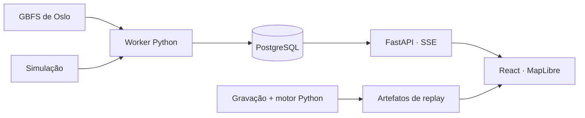

# CycleOps

<picture>
  <source media="(prefers-color-scheme: dark)" srcset="docs/brand/cycleops-lockup-light.svg">
  
</picture>

Estações do Oslo Bysykkel sem bicicleta ou sem vaga, em ordem de prioridade, com o motivo e os dados usados no cálculo. Feed GBFS aberto, mapa de Oslo e replay de uma gravação real.

[Read in English](README.en.md)

[](https://github.com/arthurjoanes/cycleops/actions/workflows/ci.yml)

<p>
  <a href="#demonstração"></a>
  <a href="#arquitetura"></a>
  <a href="#executar-localmente"></a>
  <a href="#testes-e-resultados"></a>
  <a href="https://www.linkedin.com/in/arthur-joanes-6a2967373/"></a>
</p>

## Visão geral

O CycleOps acompanha a falta de bicicletas e de vagas físicas nas estações. O motor confirma os incidentes ao longo de publicações do feed, calcula a prioridade e acompanha a recuperação. Cada linha da fila explica a decisão; os detalhes mostram contagens, horários e histórico.

O mesmo motor Python processa o feed ao vivo, as gravações e a simulação. A interface mantém o modo visível, distingue falha da conexão de dado vencido e mostra o fechamento noturno do serviço.

| Modo | Como funciona |
|---|---|
| Replay gravado | A gravação real é processada offline e reproduzida no navegador. É o modo inicial do build do Pages. |
| Simulação | Estações e contagens geradas com seed, sempre identificadas como “Simulação”. No Compose passam pelo worker e pela API; no replay vêm de um arquivo. |
| Ao vivo | O worker coleta o feed de Oslo na cadência do TTL e entrega os eventos pela API. Roda no Compose local. |

## Demonstração

[Abrir demo no navegador](https://arthurjoanes.github.io/cycleops/) · Replay gravado, sem login.


Captura de 09/10/2026 (UTC), feita com Playwright no build do Pages, reproduzindo dados reais gravados. O período e os horários exibidos pertencem à gravação. [Visualização no celular](docs/media/identity-mobile.png) · [Gravação e aceite](docs/results/feed-validation.md).

No replay, pause, escolha 5× ou 20×, avance com “Passo” ou use “Ir para o incidente”. A gravação inclui confirmação e resolução de falta de vagas em St. Olavs gate. A simulação continua disponível no seletor.

O [vídeo da interface atual](docs/media/identity-demo.webm) mostra o replay real: pausa, salto para o incidente de falta de bicicletas em Jakob kirke e reprodução em 20× até a resolução.

## Arquitetura



No Compose, o worker é o único escritor; o PostgreSQL guarda o estado e os eventos, e a API atende somente leitura. O Caddy serve a interface e encaminha as requisições à API. O build do Pages usa os artefatos de replay no navegador.

[Processos, conexões e testes](docs/architecture.md) · [Decisões de arquitetura](docs/adr/).

## Stack e decisões

| Parte | Escolha |
|---|---|
| Interface | React, TypeScript, Vite e Zustand. A interface aplica os eventos e exibe as decisões do motor. |
| Mapa e histórico | MapLibre com base local do OpenStreetMap; gráfico de degraus em SVG e tabela alternativa. |
| Motor e API | Python, Pydantic e FastAPI. As regras de incidente são compartilhadas pelo live e pelo replay. |
| Eventos e execução | PostgreSQL, SSE, Docker Compose e Caddy. O PostgreSQL também entrega os avisos de novos eventos. |

## Executar localmente

Para a aplicação inteira, precisa só de Docker. Da raiz do repositório:

```bash
docker compose up --build
```

Abra [127.0.0.1:8080](http://127.0.0.1:8080). O Compose começa na simulação. O banco fica sem porta publicada; as senhas padrão servem apenas para uso local. O [.env.example](.env.example) mostra como trocá-las.

Para o feed real, copie [.env.live.example](.env.live.example) para `.env.live`, defina `CYCLEOPS_CLIENT_IDENTIFIER` como `<organização>-<aplicação>` e use outro projeto:

```bash
docker compose -p cycleops-live --env-file .env.live up --build
```

Só uma pilha publica a porta 8080 por vez. Pare a anterior antes de trocar: `docker compose down` para a simulação ou `docker compose -p cycleops-live down` para o live. Use `--build` depois de mudar o código.

Para abrir só o replay, precisa de Node 24 com corepack:

```bash
cd apps/web
corepack pnpm install
corepack pnpm build:pages
corepack pnpm preview:pages
```

Abra [127.0.0.1:4173/cycleops/](http://127.0.0.1:4173/cycleops/). Para desenvolver, `corepack pnpm dev` abre em [localhost:5173](http://localhost:5173) e tenta o stream do Compose primeiro; sem a pilha, oferece o replay em arquivo.

## Testes e resultados

O script usa Bash, Docker, git, uv, Node 24 com corepack e o Chromium do Playwright. Ele executa as verificações locais do CI, exceto gitleaks:

```bash
scripts/checks
```

Só a web, em `apps/web`:

```bash
corepack pnpm lint
corepack pnpm typecheck
corepack pnpm test
corepack pnpm exec playwright install chromium
corepack pnpm e2e
corepack pnpm check:bundle
```

O `e2e` gera o build do Pages sob `/cycleops/`; `check:bundle` confere esse build. Os comandos do backend e do E2E contra o Compose estão no [CONTRIBUTING.md](CONTRIBUTING.md). O `e2e:compose` usa o projeto isolado `cycleops-e2e` e apaga seu banco no último teste.

| Registro | Resultado |
|---|---|
| [Publicação e CI](docs/results/publicacao.md) | 354 testes Python, 69 unitários web, 14 E2E Pages e 11 E2E Compose. Demo pública conferida em desktop e celular. |
| [Coleta real](docs/results/feed-validation.md) | 249 respostas em 60 min, todas 200. O replay tem 218 eventos e dois incidentes resolvidos. |
| [Verificação do replay e do Compose](docs/results/validacao-20261009.md) | Testes do motor, persistência, SSE, reconexão e navegador, com comandos e resultados registrados. |
| [Identidade visual](docs/results/identity-20261009.md) | 69 testes unitários, 14 E2E Pages, capturas desktop e celular e Web Vitals com ambiente e limites de comparação. |
| [Desempenho](docs/results/performance.md) | Carga do frontend, Web Vitals de laboratório e latência do Compose, com ambiente e dados de cada execução. |

O [índice de resultados](docs/results/index.md) relaciona cada execução ao comando, commit e data. As amostras diurnas adicionais e o [checklist manual de acessibilidade](docs/results/a11y-manual.md) continuam pendentes.

## Limitações e segurança

- Projeto independente, sem vínculo com Oslo Bysykkel; somente leitura, sem reserva nem despacho de equipe.
- O feed não tem SLA. O live roda só no Compose local.
- A base do mapa é simplificada e não serve para navegação.
- No Compose, cada aba usa uma conexão SSE. A API permite quatro por IP e encerra a mais antiga ao abrir a quinta.
- A CSP do Pages vai por meta e é mais limitada que a enviada pelo Caddy. Controles e retenção estão em [SECURITY.md](SECURITY.md).

## Documentação

| Para consultar | Documento |
|---|---|
| Fonte, licença e coleta | [Fontes de dados](DATA_SOURCES.md) · [Validação do feed](docs/results/feed-validation.md) |
| Implementação e decisões | [Arquitetura](docs/architecture.md) · [ADRs](docs/adr/) · [Comandos](CONTRIBUTING.md) |
| Execuções e medições | [Resultados](docs/results/index.md) · [Desempenho](docs/results/performance.md) |
| Publicação e revisão manual | [Checklist de publicação](docs/results/publicacao.md) · [Acessibilidade](docs/results/a11y-manual.md) |
| Marca e cores | [Identidade visual](docs/brand/README.md) |

## Autor e licença

Desenvolvido por Arthur Joanes. [LinkedIn](https://www.linkedin.com/in/arthur-joanes-6a2967373/).

Código sob [licença MIT](LICENSE). Dados do Oslo Bysykkel sob NLOD 2.0 e base do OpenStreetMap sob ODbL: [fontes e atribuições](DATA_SOURCES.md). Bibliotecas e demais licenças em [THIRD_PARTY_NOTICES.md](THIRD_PARTY_NOTICES.md).
