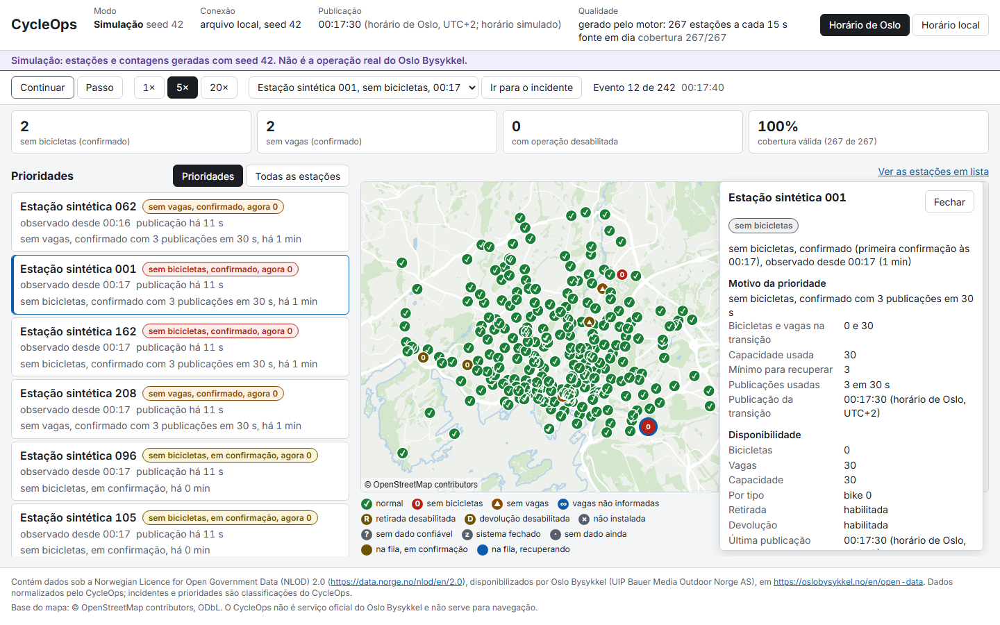

# CycleOps

Lista as estações do Oslo Bysykkel sem bicicleta ou sem vaga, em ordem de prioridade, com o motivo e os dados usados no cálculo. Os dados vêm do feed GBFS aberto do operador.



## Estado

Existem a coleta do feed, o motor de prioridade em Python, o `compile-replay` e a interface web, que reproduz no navegador os eventos gerados pelo motor. O Compose com API, worker e PostgreSQL ainda não existe, então ainda não há modo ao vivo.

## Como rodar a web

Precisa de Node 24 com corepack. Da raiz do repositório:

```bash
cd apps/web
corepack pnpm install
corepack pnpm dev
```

Abre em http://localhost:5173. Para ver o build do GitHub Pages, servido sob `/cycleops/` como no Pages:

```bash
corepack pnpm build:pages
corepack pnpm preview:pages
```

Abre em http://127.0.0.1:4173/cycleops/.

## Como testar

Em `apps/web`:

```bash
corepack pnpm lint
corepack pnpm typecheck
corepack pnpm test
corepack pnpm exec playwright install chromium
corepack pnpm e2e
corepack pnpm check:bundle
```

O `e2e` gera o build do Pages e roda o Playwright contra ele. O `check:bundle` lê o build que já existe em `dist/`. Os comandos do backend Python estão no `CONTRIBUTING.md`.

## Modos de dados

- Replay gravado: uma gravação real do feed passada pelo motor, reproduzida no navegador. Só existe quando uma gravação tem pelo menos um incidente confirmado e resolvido; ainda não há nenhuma.
- Simulação: estações e contagens geradas com seed, com a faixa "Simulação" sempre visível. É o modo que abre hoje.
- Ao vivo: o worker lendo o feed e a API mandando os eventos por SSE. Vai rodar só no Compose local.

O modo e a seed ficam no cabeçalho o tempo todo. O replay tem pausa, 1×, 5×, 20×, passo e "ir para o incidente".

## Limitações

- Não é serviço oficial do Oslo Bysykkel.
- Só leitura, sem reserva nem despacho de equipe.
- O feed não tem SLA.
- O live vai rodar só no Compose local.
- A base do mapa é simplificada e não serve para navegação.
- A CSP do Pages vai por meta e é mais fraca que a do Caddy (ver `SECURITY.md`).

## Fontes e licenças

- Dados do Oslo Bysykkel sob NLOD 2.0 e base do mapa do OpenStreetMap sob ODbL: `DATA_SOURCES.md`.
- Software de terceiros: `THIRD_PARTY_NOTICES.md`.
- Código sob a licença MIT: `LICENSE`.

Decisões de arquitetura em `docs/adr/`. Resultados de execução, com commit e comando, em `docs/results/`.
