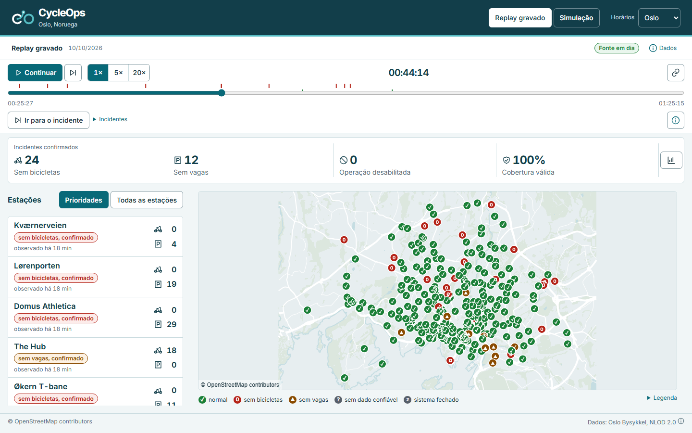
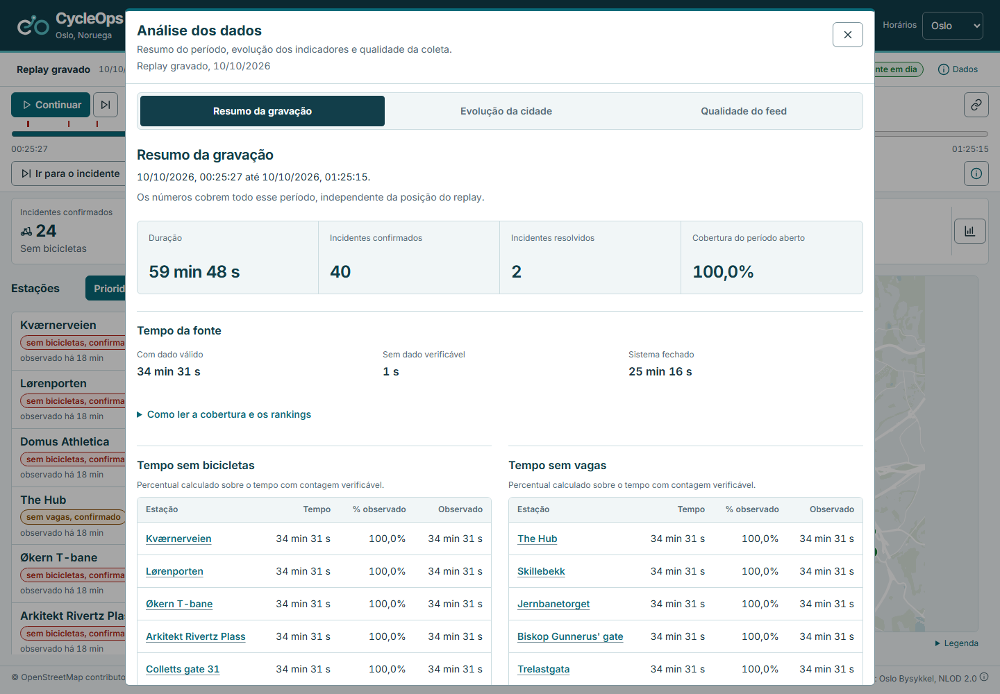
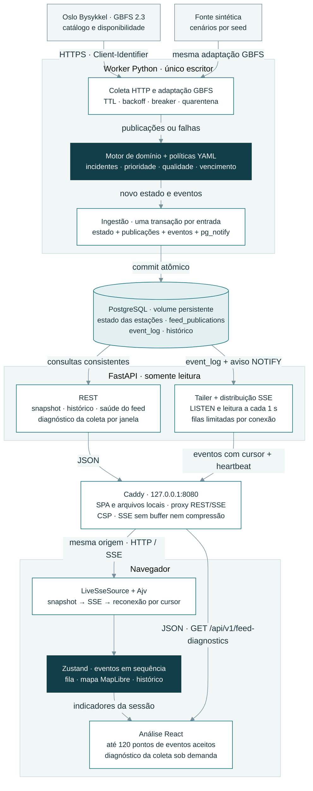
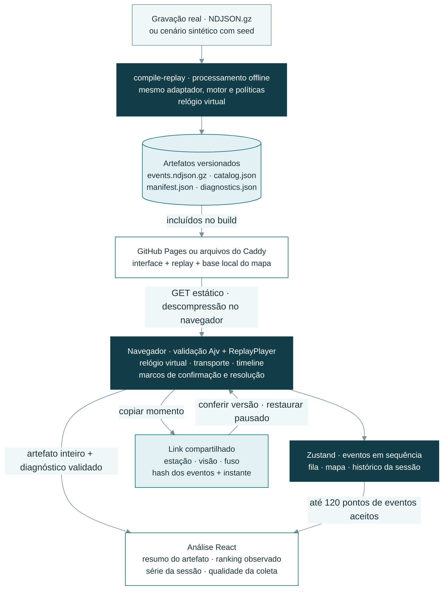

# CycleOps

<picture>
  <source media="(prefers-color-scheme: dark)" srcset="docs/brand/cycleops-lockup-light.svg">
  
</picture>

O CycleOps lista estações do Oslo Bysykkel sem bicicleta ou sem vaga, em ordem de prioridade, com o motivo e os dados usados no cálculo. Usa o feed GBFS aberto, um mapa de Oslo e o replay de uma gravação real.

[Read in English](README.en.md)

[](https://github.com/arthurjoanes/cycleops/actions/workflows/ci.yml)

<p>
  <a href="#demonstração"></a>
  <a href="#arquitetura"></a>
  <a href="#executar-localmente"></a>
  <a href="#testes-e-resultados"></a>
  <a href="https://www.linkedin.com/in/arthur-joanes-6a2967373/"></a>
</p>

## Visão geral

O CycleOps organiza estações do Oslo Bysykkel que estão sem bicicletas ou sem vagas físicas. Quem acompanha a disponibilidade pode abrir uma ocorrência, conferir as contagens e ver por que ela entrou naquela posição da fila.

O motor confirma a falta ao longo de publicações do feed e acompanha sua resolução. Uma falha de conexão, um dado vencido e o fechamento noturno têm estados próprios na interface. A [política](policy/priority-policy.yaml) define os critérios; o [motor Python](apps/backend/src/cycleops/domain/engine.py) aplica as mesmas regras ao live, às gravações e à simulação.

É um projeto de portfólio com dados abertos. A demonstração pública usa uma gravação real; a coleta ao vivo roda no Compose local.

| Modo | Como funciona |
|---|---|
| Replay gravado | A gravação real é processada offline e reproduzida no navegador. É o modo inicial do build do Pages. |
| Simulação | Estações e contagens geradas com seed, sempre identificadas como “Simulação”. No Compose passam pelo worker e pela API; no replay vêm de um arquivo. |
| Ao vivo | O worker coleta o feed de Oslo na cadência do TTL e entrega os eventos pela API. Roda no Compose local. |

## Demonstração

[Abrir demo no navegador](https://arthurjoanes.github.io/cycleops/) · Replay gravado, sem login.



Captura de 12/10/2026, feita com Playwright no build do Pages. O período e os horários exibidos pertencem à gravação real. [Celular](docs/media/uiux-mobile.png) · [Tablet](docs/media/uiux-tablet.png) · [Gravação e aceite](docs/results/feed-validation.md).

Escolha um horário na linha do tempo ou use “Ir para o incidente”. “Incidentes” abre os marcos de confirmação e resolução. O ícone de link copia a estação e o horário, com o replay pausado.

O botão de gráfico abre “Analisar dados”: tempo observado sem bicicletas ou vagas por estação, evolução dos indicadores e qualidade da coleta. Na tela principal, as contagens acompanham o mapa; detalhes da sessão e legendas ficam em painéis expansíveis.



[Como explorar os dados](docs/explorar-dados.md) · [Interface e navegação](docs/ui-ux.md) · [Revisão da interface](docs/results/uiux-20261012.md).

Na gravação de 09/10/2026, o motor produziu estes eventos. Os links abrem os instantes registrados, no horário de Oslo:

| Estação e condição | Confirmação | Resolução |
|---|---|---|
| St. Olavs gate (537), sem vagas | [Evento 69 · 00:44:14](https://arthurjoanes.github.io/cycleops/#/?mode=recorded&station=537&artifact=48e2c7d55854510f1845b9ef2950aa0274a7c0f4363f090a71032f3b0eed0031&at=1126.445) | [Evento 95 · 00:51:29](https://arthurjoanes.github.io/cycleops/#/?mode=recorded&station=537&artifact=48e2c7d55854510f1845b9ef2950aa0274a7c0f4363f090a71032f3b0eed0031&at=1561.645) |
| Jakob kirke (412), sem bicicletas | [Evento 106 · 00:54:29](https://arthurjoanes.github.io/cycleops/#/?mode=recorded&station=412&artifact=48e2c7d55854510f1845b9ef2950aa0274a7c0f4363f090a71032f3b0eed0031&at=1741.76) | [Evento 124 · 00:59:29](https://arthurjoanes.github.io/cycleops/#/?mode=recorded&station=412&artifact=48e2c7d55854510f1845b9ef2950aa0274a7c0f4363f090a71032f3b0eed0031&at=2041.909) |

O [manifesto do replay](apps/web/public/replay/recorded/manifest.json) registra esses pontos e os hashes dos arquivos; a [validação da coleta](docs/results/feed-validation.md) descreve a janela e seus limites. O [vídeo da demonstração](docs/media/identity-demo.webm) acompanha Jakob kirke da confirmação à resolução em 20×.

## Arquitetura

O backend é um monólito modular com dois processos: o worker calcula e persiste as decisões; a API entrega o estado e os eventos ao navegador. Há dois caminhos de execução, ambos com o mesmo motor de domínio Python.

### Operação no Compose

As setas mostram o fluxo dos dados. O worker usa a fonte real ou a sintética conforme a configuração; o Caddy é a única porta publicada.



- O motor recebe estado, entrada e política, e retorna estado e eventos. Ele não acessa rede, banco ou relógio do sistema.
- Estado e eventos entram no mesmo commit. `pg_notify` apenas acorda o tailer; os eventos são lidos do `event_log`, inclusive após perda de um aviso.
- A API usa sessões curtas no banco. Cada conexão SSE tem sua própria fila e retoma pelo cursor; quando o cursor não pode ser recuperado, o navegador busca um novo snapshot.
- A interface valida os contratos e aplica eventos em ordem. As decisões de incidente e prioridade vêm do motor.

### Replay publicado no GitHub Pages

O processamento acontece antes do build. A demo pública reproduz eventos já calculados, sem API, banco ou chamadas ao feed de Oslo. O Compose também oferece esses arquivos como opção de replay.



Os contratos Pydantic geram JSON Schema e tipos TypeScript; o Ajv valida as respostas e os artefatos no navegador. A política e suas versões acompanham os dados gerados.

O resumo usa os eventos da gravação inteira. Os rankings contam apenas intervalos observados com dados válidos; períodos sem dados e fechamento aparecem separados. O diagnóstico acompanha o artefato em `diagnostics.json` e, no stream, vem de uma consulta REST. A evolução da cidade guarda até 120 pontos de eventos aceitos; ao saltar no replay, reconstrói os últimos pontos até o instante escolhido.

[Transação, entrega SSE e recuperação em sequência](docs/architecture.md#da-entrada-ao-navegador) · [Processos, conexões e testes](docs/architecture.md) · [Decisões de arquitetura](docs/adr/).

| Responsabilidade | Implementação |
|---|---|
| Coletar e normalizar | [Coletor](apps/backend/src/cycleops/collection/collector.py) e [adaptador GBFS](apps/backend/src/cycleops/adapters/gbfs.py): cadência, falhas e dados normalizados. |
| Decidir e persistir | [Motor](apps/backend/src/cycleops/domain/engine.py) e [ingestão](apps/backend/src/cycleops/application/ingest.py): incidentes, prioridade e commit do estado com os eventos. |
| Entregar e recuperar | [Tailer](apps/backend/src/cycleops/api/tailer.py) e [stream SSE](apps/backend/src/cycleops/api/stream.py): leitura do log, filas por conexão e recuperação pelo cursor. |
| Reproduzir e apresentar | [Compilador](apps/backend/src/cycleops/application/replay.py), [sessão de dados](apps/web/src/app/useDataSession.ts) e [store](apps/web/src/features/stations/store.ts): live e replay chegam aos mesmos componentes. |
| Explorar e diagnosticar | [Análise no navegador](apps/web/src/features/analysis/), [link do replay](apps/web/src/features/replay/replayMoment.ts) e [relatório da coleta](apps/backend/src/cycleops/application/feed_diagnostics.py): resumo, indicadores e motivos por tentativa. |

## Stack e decisões

<a id="stack"></a>

<p>
  
  
  
  
  
  
  
  
</p>

| Escolha | Motivo e compromisso |
|---|---|
| Python + Pydantic + FastAPI | O mesmo motor processa live e replay, com contratos gerados para a web. Mudanças no domínio exigem regenerar os artefatos. |
| PostgreSQL + SSE | Estado e eventos compartilham uma transação; o navegador recebe atualizações por um fluxo unidirecional. O tailer consulta o banco a cada segundo e cada aba mantém uma conexão SSE. |
| React + TypeScript + Zustand | O store aplica os eventos em sequência e compartilha o estado entre fila, mapa e detalhes. Lacunas na sequência exigem recuperar eventos ou buscar um snapshot. |
| MapLibre + base local do OpenStreetMap | O mapa funciona com arquivos servidos junto da interface. A base é simplificada e precisa ser regenerada para incorporar mudanças geográficas. |
| Vite + GitHub Pages | A demo pública reproduz uma gravação sem backend ativo. Novos dados gravados dependem de compilação e publicação dos artefatos. |
| Docker Compose + Caddy | Reúne banco, worker, API e web em uma instalação local. Os serviços compartilham o mesmo host. |

[Alternativas para entrega de eventos](docs/adr/0003-entrega-de-eventos-sem-broker.md#alternativas) · [Escolhas do replay](docs/adr/0004-replay-no-navegador.md#alternativas) · [Estado e renderização](docs/adr/0005-estado-e-renderizacao.md) · [Exploração e diagnóstico](docs/adr/0006-exploracao-e-diagnostico.md).

Dependências fixadas: [Python](apps/backend/uv.lock), [web](apps/web/pnpm-lock.yaml) e [imagens do Compose](compose.yaml).

## Executar localmente

Use Docker com containers Linux e Docker Compose. Na raiz do repositório:

```bash
docker compose up --build
```

Abra [127.0.0.1:8080](http://127.0.0.1:8080). O Compose começa na simulação. O banco fica sem porta publicada; as senhas padrão servem apenas para uso local. O [.env.example](.env.example) mostra como trocá-las.

Para o feed real, copie [.env.live.example](.env.live.example) para `.env.live`, defina `CYCLEOPS_CLIENT_IDENTIFIER` como `<organização>-<aplicação>` e use outro projeto:

```bash
docker compose -p cycleops-live --env-file .env.live up --build
```

Só uma pilha publica a porta 8080 por vez. Pare a anterior antes de trocar: `docker compose down` para a simulação ou `docker compose -p cycleops-live down` para o live. Use `--build` depois de mudar o código.

Para abrir só o replay, use Node 24 com corepack:

```bash
cd apps/web
corepack pnpm install
corepack pnpm build:pages
corepack pnpm preview:pages
```

Abra [127.0.0.1:4173/cycleops/](http://127.0.0.1:4173/cycleops/). Para desenvolver, `corepack pnpm dev` abre em [localhost:5173](http://localhost:5173) e tenta o stream do Compose primeiro; sem a pilha, oferece o replay em arquivo.

## Testes e resultados

O script usa Bash (Git Bash ou WSL no Windows), Docker, git, uv, Node 24 com corepack e o Chromium do Playwright. Ele executa as verificações locais do CI, exceto gitleaks:

```bash
scripts/checks
```

Só a web, em `apps/web`:

```bash
corepack pnpm lint
corepack pnpm typecheck
corepack pnpm test
corepack pnpm exec playwright install chromium
corepack pnpm e2e
corepack pnpm check:bundle
```

O `e2e` gera o build do Pages sob `/cycleops/` e inicia seu próprio servidor em 4188. Ele não reutiliza um servidor aberto; `CYCLEOPS_WEB_TEST_PORT` permite escolher outra porta. O preview manual continua em 4173. `check:bundle` confere o build gerado. Os comandos do backend e do E2E contra o Compose estão no [CONTRIBUTING.md](CONTRIBUTING.md). O `e2e:compose` usa o projeto isolado `cycleops-e2e` e apaga seu banco no último teste.

| Pergunta | Registro e resultado | Alcance |
|---|---|---|
| Backend e navegador passaram nos testes? | [CI da publicação](docs/results/publicacao.md), 09/10/2026 no horário de Brasília, commit `185e5af`: 354 testes Python, 69 unitários web, 14 E2E Pages e 11 E2E Compose. | A execução identifica a revisão testada; o job Compose usa a fonte sintética sem internet. |
| A revisão da interface foi verificada? | [Revisão de 12/10/2026](docs/results/uiux-20261012.md): 110 unitários web, 28 cenários de navegação e quatro capturas. | Teclado, alinhamento e legenda conferidos em 1440, 768 e 320 px; métricas de laboratório registradas no relatório. |
| A gravação contém incidentes resolvidos? | [Coleta real](docs/results/feed-validation.md), 09/10/2026: 249 respostas em 60 min, todas 200; 218 eventos e dois incidentes resolvidos no replay. | A janela inclui o fechamento noturno e não representa o movimento diurno. |
| Como conferir o que entrou no motor? | [Relatório de exploração](docs/results/exploracao-20261011.md): a gravação contém 225 publicações aceitas e 24 repetidas, além de 40 incidentes confirmados e dois resolvidos. | Resposta HTTP, publicação aceita e evento do motor têm contagens distintas. |
| A demo publicada abre em desktop e celular? | [Roteiro no endereço público](docs/results/data/public-pages-20261010.json), 09/10/2026 às 21:08 em Brasília: pausa, salto para incidente e mapa em 1440×900 e 320×900. | Sem overflow ou erros no roteiro; a revisão manual de acessibilidade continua pendente. |
| Como a interface se comportou no laboratório? | [Revisão visual](docs/results/identity-20261009.md), 09/10/2026: bundle de 119.270 bytes gzip; medianas de LCP 3.248 ms, CLS 0,004 e INP 240 ms em três execuções. | Chromium com CPU e rede emuladas; os números não são métricas de visitas reais. |

O [índice de resultados](docs/results/index.md) reúne comandos, commits e datas. A [validação do replay e do Compose](docs/results/validacao-20261009.md) cobre persistência e reconexão; o [relatório de desempenho](docs/results/performance.md) guarda os cenários de carga e latência. As amostras diurnas adicionais e o [checklist manual de acessibilidade](docs/results/a11y-manual.md) continuam pendentes.

<a id="limitações-e-segurança"></a>

## Limites e segurança

- Projeto independente, sem vínculo com Oslo Bysykkel; somente leitura, sem reserva nem despacho de equipe.
- O feed não tem SLA. O live roda só no Compose local; os critérios de coleta e frescor estão na [política da fonte](policy/provider-oslo.yaml) e na [política de prioridade](policy/priority-policy.yaml).
- A base do mapa é simplificada e não serve para navegação.
- Rankings usam apenas a janela da gravação e as contagens observadas. Eles não estimam viagens ou padrões semanais; a série da cidade cobre até 120 pontos de eventos aceitos na sessão ou no prefixo reproduzido.
- No Compose, cada aba usa uma conexão SSE. A API permite quatro por IP e encerra a mais antiga ao abrir a quinta. [Limites e recuperação](docs/architecture.md#ligações).
- A CSP do Pages vai por meta e é mais limitada que a enviada pelo Caddy. Controles e retenção estão em [SECURITY.md](SECURITY.md).

## Documentação

| Para consultar | Documento |
|---|---|
| Fonte, licença e coleta | [Fontes de dados](DATA_SOURCES.md) · [Validação do feed](docs/results/feed-validation.md) |
| Implementação e decisões | [Arquitetura](docs/architecture.md) · [ADRs](docs/adr/) · [Comandos](CONTRIBUTING.md) |
| Replay, indicadores e qualidade | [Explorar os dados](docs/explorar-dados.md) · [Validação da exploração](docs/results/exploracao-20261011.md) |
| Interface e navegação | [Guia da interface](docs/ui-ux.md) · [Revisão da interface](docs/results/uiux-20261012.md) |
| Execuções e medições | [Resultados](docs/results/index.md) · [Desempenho](docs/results/performance.md) |
| Publicação e revisão manual | [Checklist de publicação](docs/results/publicacao.md) · [Acessibilidade](docs/results/a11y-manual.md) |
| Apresentação | [Identidade visual](docs/brand/README.md) · [Padrão documental](docs/padrao-documentacao.md) |

## Autor e licença

Desenvolvido por Arthur Joanes. Para conversar sobre dados abertos, eventos e operação de estações:

<p>
  <a href="https://www.linkedin.com/in/arthur-joanes-6a2967373/">
    
    <strong>Arthur Joanes no LinkedIn</strong>
  </a>
</p>

Código sob [licença MIT](LICENSE). Dados do Oslo Bysykkel sob NLOD 2.0 e base do OpenStreetMap sob ODbL: [fontes e atribuições](DATA_SOURCES.md). Bibliotecas e demais licenças em [THIRD_PARTY_NOTICES.md](THIRD_PARTY_NOTICES.md).

Ícones Devicon e Simple Icons: [fontes e licenças](THIRD_PARTY_NOTICES.md#documentation-icons).
