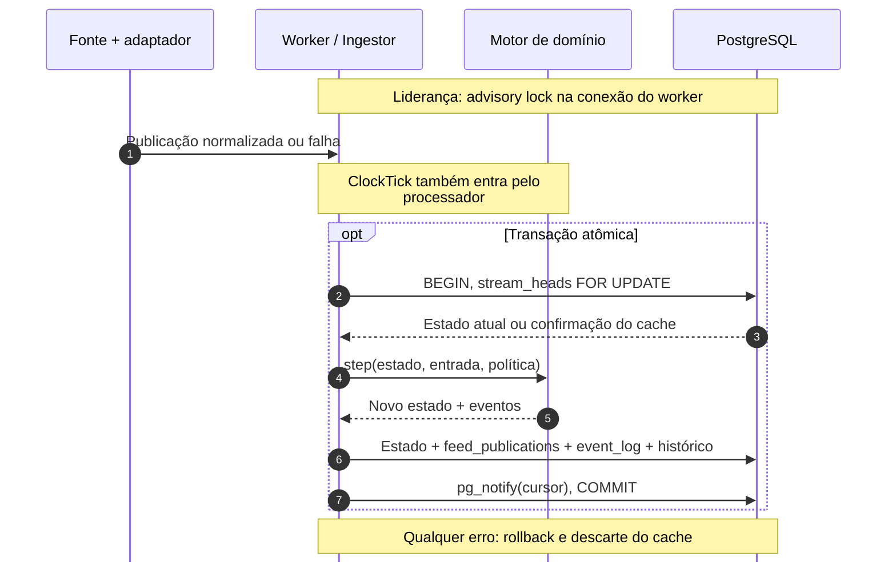
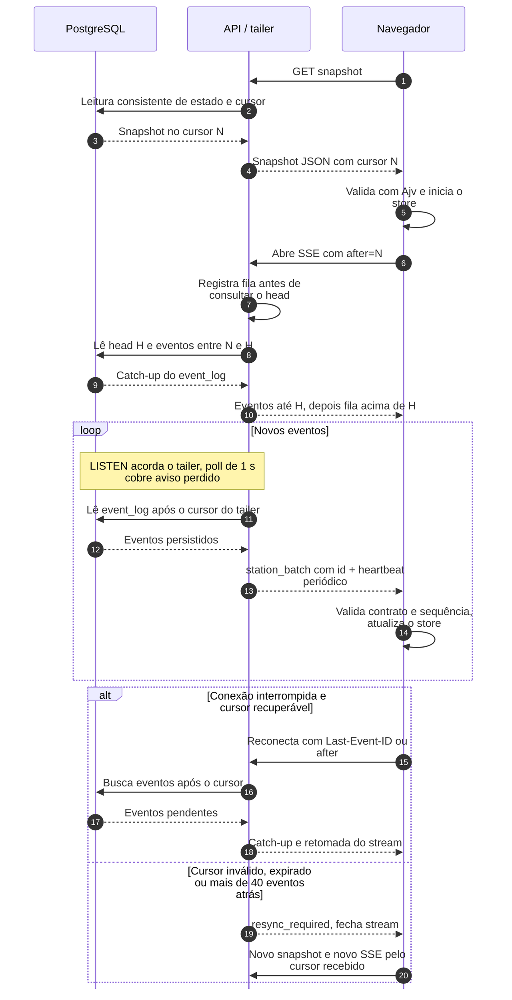
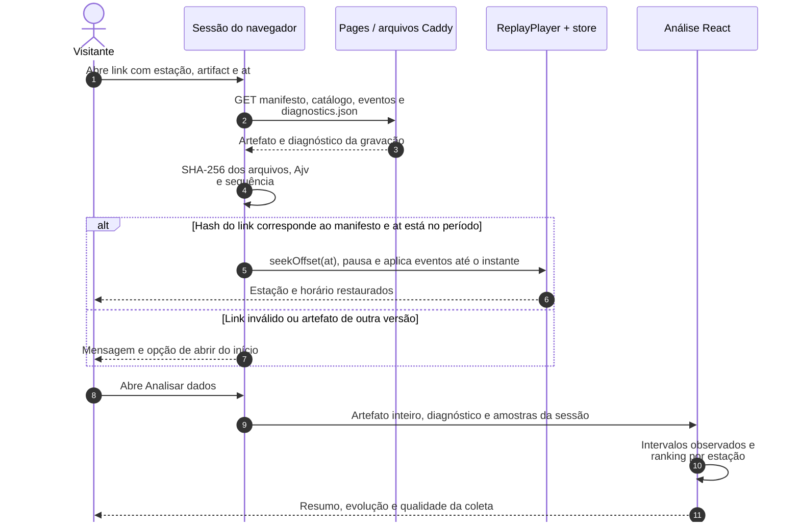

# Arquitetura

O backend é um monólito modular em Python com dois processos, `worker` e `api`. O PostgreSQL é a fonte de verdade e o único caminho dos eventos. O replay roda no navegador, com os mesmos artefatos no GitHub Pages e no Compose. As decisões estão em `docs/adr/`.

## Da entrada ao navegador

O [diagrama de componentes](../README.md#arquitetura) separa a operação no Compose do replay estático. A sequência abaixo detalha o commit, a entrega e a recuperação no modo stream. O Caddy encaminha todas as chamadas do navegador à API; foi omitido da sequência para concentrar a leitura no protocolo.

### Transação do worker

### Snapshot, stream e recuperação

O snapshot e o stream podem observar commits diferentes. A inscrição na fila antes da leitura do head permite recuperar o intervalo pelo banco e depois consumir o que chegou durante a consulta, descartando eventos já enviados. Nenhuma conexão SSE mantém uma sessão de banco aberta durante toda sua duração.

## Motor compartilhado e contratos

| Fronteira | Responsabilidade | Implementação |
|---|---|---|
| Entrada GBFS | Valida e normaliza o catálogo e as contagens; classifica falhas de coleta | `collection/`, `adapters/gbfs.py`, `application/replay.py` |
| Domínio | Aplica a política a publicações, falhas e ticks; produz decisões e eventos | `domain/engine.py`, `policy/` |
| Persistência live ou sintética | Executa o motor dentro da transação e salva estado, publicações e eventos | `application/ingest.py`, `adapters/postgres/` |
| Compilação offline | Executa o mesmo motor com relógio virtual e gera eventos, catálogo, manifesto e diagnóstico da coleta | `application/replay.py`, `application/feed_diagnostics.py`, `cli/compile_replay.py` |
| Contrato Python → web | Gera JSON Schema e tipos TypeScript a partir de Pydantic; valida com Ajv | `contracts.py`, `packages/contracts/`, `apps/web/src/lib/contracts.ts` |
| Aplicação no navegador | Seleciona stream ou arquivo e aplica os eventos ao mesmo store | `useDataSession.ts`, `LiveSseSource`, `ReplayPlayer`, `features/stations/store.ts` |
| Análise no navegador | Integra os intervalos observados do replay e guarda a evolução dos indicadores dos eventos aceitos na sessão | `features/analysis/recordingReport.ts`, `features/analysis/cityHistory.ts`, `features/analysis/AnalysisPanel.tsx` |
| Diagnóstico da coleta | Conta tentativas, respostas, falhas de contrato e resultados de publicação; a mesma função atende gravações e linhas do banco | `application/feed_diagnostics.py`, `adapters/postgres/queries.py`, `api/routes.py` |

Os caminhos do backend na tabela são relativos a `apps/backend/src/cycleops/`, exceto `policy/` e `packages/contracts/`, que ficam na raiz. O replay publicado dispensa os processos worker e API em execução: as decisões já estão nos artefatos. A base do mapa também é servida como arquivo local.

## Exploração do replay e da coleta

“Copiar este momento” grava na URL o modo, a estação, as opções da tela, `artifact` com o SHA-256 dos eventos e `at` em segundos desde `manifest.periodStart`, com precisão de milissegundos. O navegador confere a versão antes de restaurar o instante pausado. Um hash diferente ou um horário inválido gera uma mensagem e a opção de abrir do início. Mudar estação, busca ou fuso mantém o player; voltar ou avançar para outro momento da URL reposiciona o player existente.

A timeline percorre o período inteiro, incluindo intervalos sem dados e fechamento. Os marcos usam o `committedAt` dos eventos de confirmação e resolução indicados no manifesto. Os offsets dos incidentes no manifesto contam do primeiro evento; o início da gravação pode preceder esse commit.

O resumo integra as contagens entre commits da gravação inteira, usando `applyEvents` para recuperar os estados já decididos pelo motor. Zero bicicletas e zero vagas entram no ranking apenas em intervalos observados válidos. Tempo fechado, estações fora do catálogo, vagas desconhecidas e lacunas ficam fora desses denominadores. A cobertura do período aberto usa o tempo válido dividido pelo tempo válido mais as lacunas das estações no catálogo.

A série da cidade guarda até 120 pontos de eventos aceitos e usa as mesmas contagens dos indicadores. Eventos repetidos, de outro fluxo ou com lacuna na sequência não entram. Troca de fonte e snapshot novo reiniciam a série. Um salto no replay reconstrói os últimos 120 pontos do prefixo até o instante escolhido. Fonte indisponível ou fechada aparece como lacuna, com uma tabela alternativa ao gráfico.

No replay, o compilador gera `diagnostics.json` a partir das tentativas da gravação. O loader valida contrato, SHA-256, fluxo, modo e período contra o manifesto. Manifestos antigos sem `diagnosticsSha256` continuam reproduzíveis e informam que o relatório não está disponível. No stream, “Qualidade do feed” consulta `GET /api/v1/feed-diagnostics` pelo Caddy: seis horas por padrão, janela `from`/`to` de até 24 horas. A API lê `feed_publications` com o papel somente leitura e usa o mesmo limite REST por IP.

O [guia de exploração](explorar-dados.md) descreve os controles e denominadores. O [ADR 0006](adr/0006-exploracao-e-diagnostico.md) registra as decisões dessa análise. O [registro da revisão](results/exploracao-20261011.md) reúne os comandos e as capturas da interface.

## Processos

No Compose (`compose.yaml`):

- `postgres`: PostgreSQL 18.6 com o volume `pgdata`, sem porta publicada.
- `migrate`: roda uma vez. Cria os papéis como superusuário e aplica as migrações do Alembic como `cycleops_migrator`. `worker` e `api` só sobem depois que ele termina com sucesso.
- `worker` (`python -m cycleops.worker`): um laço de liderança pega o advisory lock do coletor. Cada mandato roda a fonte (coletor live ou sintético), o processador (uma transação por entrada), o ticker de 5 s e a purga a cada 10 min com a checagem de cota. Uma thread de watchdog atualiza o arquivo de heartbeat a cada 5 s e encerra o processo (código 3) se um laço passa 60 s sem progresso. No live, a fonte grava o arquivo bruto.
- `api` (`python -m cycleops.api`, um uvicorn): rotas REST, uma sessão SSE por conexão e, no lifespan, o tailer do `event_log`, o log de latência a cada 60 s e o fechamento dos streams no SIGTERM.
- `edge` (Caddy): serve a interface e os artefatos e faz proxy de `/api/*` e `/health/*` para a `api`. É o único serviço na rede `public`, em `127.0.0.1:8080`.

Fora do Compose: as CLIs rodadas à mão (`inspect-feed`, `record-feed`, `compile-replay`, `generate-artifacts`), os workflows do GitHub Actions (`ci`, `pages`, `feed-check`) e o navegador.

## Ligações

Testes do backend em `apps/backend/tests/`, da web em `apps/web/tests/`.

| Ligação | Protocolo | Falha e recuperação | Teste que cobre |
|---|---|---|---|
| Navegador e Caddy: interface estática | HTTP em `127.0.0.1:8080`. CSP por header, `nosniff`, `Referrer-Policy` e `Permissions-Policy` em toda resposta; `index.html` com `no-cache`, `/assets/*` com cache longo. Rota desconhecida vira `index.html`, menos em `/assets`, `/replay` e `/basemap` | Edge fora: a página não abre, e o restart sobe o Caddy. Arquivo ausente em `/assets`, `/replay` ou `/basemap` dá 404 | `compose/stack.spec.ts`: "edge headers: CSP, nosniff, referrer, permissions, no-cache on index.html" e "no CSP violation with the stream and the map running" |
| Navegador e GitHub Pages | Build `pages` com a CSP em `<meta>` e sem fallback de SPA | Arquivo ausente dá 404 | `e2e/pages.spec.ts`: "dist/index.html has the CSP meta before any script or link" e "no CSP violation with the map and the replay running", contra `apps/web/scripts/serve-pages.mjs`, que imita o Pages |
| Navegador e API REST, pelo Caddy | GET na mesma origem: snapshot, history, feed-health e feed-diagnostics. JSON validado com Ajv, timeout de 10 s, 60 requisições por minuto por IP | API fora: 502 do Caddy, tratado como falha. Banco fora: 503. Primeiro snapshot com erro: a tela mostra o erro, com "Tentar de novo" e o replay em arquivo, e para. Snapshot com erro depois do primeiro: nova tentativa com backoff. Resposta de outro fluxo ou estação é descartada | `scripts/smoke`; `integration/test_api.py::test_rest_routes`; `test_api.py::test_database_down_is_a_503` e `::test_rest_rate_limit_per_ip`; `unit/live.test.ts`: "rejects an event, a snapshot and a history of another stream" e "shows the bootstrap error when the first snapshot fails, and stops" |
| SSE: cursor, catch-up e resync | `EventSource` em `/api/v1/stream/stations`, cursor por `Last-Event-ID` ou `?after=`, sempre 200, `id:` só em `station_batch` | Cursor malformado, de outro fluxo ou à frente: `resync_required`. Mais de 40 eventos atrás: `resync_required`. O catch-up lê o `event_log` em sessões curtas e não repete o que já saiu. No navegador só entra `last + 1`; um salto reconecta do último cursor, e dois seguidos pedem snapshot | `integration/test_api.py::test_resync_rules_and_catch_up` e `::test_buffer_above_head_and_gaps_are_written_once`; `test_api.py::test_control_messages_never_carry_an_id`; `unit/live.test.ts`: "applies only last + 1 and reconnects from the last applied cursor on a gap" e "takes a new snapshot when the gap repeats" |
| SSE pelo Caddy | Rota do stream sem compressão e com flush imediato; `Cache-Control: no-store, no-transform` | Se o edge comprimisse ou segurasse buffer, os eventos chegariam em bloco | `compose/stack.spec.ts`: "the SSE response through the edge has no Content-Encoding" e "opens the simulation over SSE, connected"; `scripts/smoke` |
| SSE: heartbeat e vigia do navegador | Heartbeat a cada 15 s com o estado da fonte pela regra de vencimento da API | Tailer sem ler o banco há mais de 3 s: o stream termina sem mensagem. Navegador 40 s sem mensagem: conexão "suspeita" e reconexão. Conexão fechada: consulta o feed-health e reconecta com backoff de 1 a 30 s com jitter. Aba oculta por mais de 5 min: snapshot novo | `integration/test_api.py::test_worker_stopped_is_stale_in_heartbeat_snapshot_and_feed_health`; `unit/live.test.ts`: "marks the connection suspect after 40 s without heartbeat or event, then reconnects" e "takes a new snapshot after more than 5 min hidden"; `compose/stack.spec.ts`: "a frozen connection turns suspect within 40 s and reconnects" e "with the worker stopped the page shows the source stale" |
| SSE: limites | 4 streams por IP (o mais antigo recebe `superseded`), 100 por instância (`capacity`), fila de 200 mensagens ou 4 MiB por conexão, timeout de escrita. O IP vem só do endereço fixo do edge | `superseded` é final, com botão para reconectar. `capacity` reconecta com backoff. Fila cheia vira `resync_required` | `integration/test_api.py::test_sse_limits_per_ip_and_per_instance`, `::test_queue_overflow_ends_the_stream` e `::test_a_client_that_stops_reading_is_reset`; `compose/stack.spec.ts`: "five tabs with forged X-Forwarded-For: the oldest is superseded" |
| SSE: desligamento | No SIGTERM cada stream manda `stream_closed` (`shutdown`, `retry: 2000`) e termina em até 5 s; o uvicorn espera 10 s e o Compose 20 s | O navegador reabre a partir do cursor, com backoff | `integration/test_api_shutdown.py::test_sigterm_sends_stream_closed_before_the_graceful_timeout`; `unit/live.test.ts`: "reopens after shutdown and capacity with growing backoff; superseded is terminal" |
| API e PostgreSQL | psycopg async, pool de 5 + 5. Snapshot e history em `REPEATABLE READ READ ONLY`. Papel `cycleops_api`, só SELECT. Nenhum stream segura conexão | Banco fora: 503 nas rotas e no `/health/ready`; os streams terminam sem mensagem. A conexão morta é descartada e a seguinte reconecta | `integration/test_queries.py::test_snapshot_is_one_instant_even_with_a_commit_between_its_reads`; `integration/test_api.py::test_streams_above_the_pool_leave_the_snapshot_answering`; `integration/test_roles.py::test_api_role_only_reads`; `test_api.py::test_route_inventory_is_read_only` |
| Tailer da API e PostgreSQL | Conexão dedicada com `LISTEN cycleops_events`; lê o `event_log` a cada 1 s ou quando chega um aviso, em páginas de 100 | Aviso perdido custa até 1 s. Conexão perdida: nova tentativa com backoff até 30 s. Fluxo novo: as conexões do fluxo antigo recebem `resync_required` | `integration/test_api.py::test_two_tailers_receive_every_event`, `::test_a_new_stream_sends_open_connections_to_resync` e `::test_a_tailer_that_cannot_read_ends_the_streams_without_a_message`; `compose/stack.spec.ts`: "a database reset with the page open leads to a resync on the new stream" |
| Worker e feed de Oslo | HTTPS só para `gbfs.urbansharing.com/oslobysykkel.no/<feed>.json`, sem redirect nem proxy do ambiente, prazo total por requisição, corpo até 2 MiB, `Client-Identifier` obrigatório. Uma requisição em voo por feed, na cadência do TTL | Toda falha vira uma tentativa classificada. 3 falhas de transporte seguidas no `station_status` abrem o breaker (só ele tem breaker); erro de contrato põe o feed em quarentena com sondas a cada 5 min; 404 tenta a redescoberta. Depois de um restart, a cadência continua da última tentativa gravada. Com a cota estourada, nenhuma requisição | `test_client.py::test_url_outside_allowlist_is_never_requested`, `::test_redirect_is_not_followed`, `::test_total_deadline_stops_a_slow_trickle` e `::test_429_respects_retry_after`; `test_collector.py::test_one_request_in_flight_per_feed`, `::test_breaker_opens_after_three_transport_failures_then_half_open` e `::test_contract_error_quarantines_and_a_valid_probe_ends_it`; `integration/test_worker.py::test_neither_a_new_term_nor_a_restart_polls_a_feed_early`; teste manual em `docs/results/live-manual.md` |
| Worker e PostgreSQL | Conexão dedicada com `pg_try_advisory_lock` e keepalives nos dois lados. Uma transação por entrada nessa conexão: `stream_heads` com `FOR UPDATE`, estado, `feed_publications`, `event_log` e `pg_notify` | Outro worker com o lock: espera. Banco fora: backoff de 1 a 30 s. Erro de conexão no mandato: rollback, cache descartado, fim do mandato e recarga do banco no seguinte. Banco com fluxo de outro modo: sai com código 2 | `integration/test_ingest.py::test_state_event_and_attempt_are_one_commit`, `::test_an_error_rolls_everything_back_and_the_next_entry_reloads` e `::test_killing_the_lock_connection_mid_entry_ends_the_leadership_without_writing`; `integration/test_worker.py::test_synthetic_worker_commits_notifies_and_comes_back_after_losing_the_lock`; `integration/test_state.py::test_restart_before_every_step_gives_the_same_events`; `test_worker_main.py::test_leadership_terms_back_off_until_one_runs_long_enough` |
| Worker e arquivo bruto | NDJSON com gzip em `/data/archive`, um arquivo por hora, só no live. Ao abrir arquivo, remove os anteriores com última escrita há mais de 48 h e os mais antigos enquanto o conjunto passa de 500 MiB. Preserva o ativo, que pode ultrapassar esse valor entre rotações | Um crash perde no máximo a linha em escrita, e o arquivo cortado é lido até onde dá. Falha de escrita só gera log | `test_worker_archive.py::test_one_file_per_received_hour_and_a_new_file_after_a_restart`, `::test_read_archive_keeps_the_lines_of_a_file_cut_short`, `::test_prune_by_age_then_by_size_oldest_first` e `::test_writer_prunes_when_it_opens_a_file` |
| Watchdog e healthcheck do worker | Thread fora do event loop; o healthcheck do Compose lê a idade do arquivo de heartbeat | Laço parado por 60 s: o processo sai com código 3 e o `restart: unless-stopped` sobe outro. O healthcheck só marca o container | `test_worker_watchdog.py::test_heartbeat_while_every_loop_progresses_and_none_after_a_stall` e `::test_the_thread_exits_with_code_3_on_a_stall`; `integration/test_worker.py::test_the_watchdog_ends_a_worker_whose_processor_stalls` |
| `migrate` e PostgreSQL | Como superusuário: papéis, senhas como verificador SCRAM, dono do banco, `REVOKE CONNECT`. Depois `alembic upgrade head` como `cycleops_migrator` | Idempotente. Sai com 2 sem variável e com 1 em erro de banco; sem ele, `worker` e `api` não sobem | `integration/test_migrate.py::test_migrate_twice_is_safe_and_logs_json` e `::test_migrate_exit_codes`; `integration/test_roles.py::test_ownership_connect_and_default_privileges` |
| CLIs de coleta e lock | Com `DATABASE_URL`: o mesmo advisory lock do worker, conferido a cada 5 s durante a coleta | Lock com outro processo: sai com 4 sem chamar o feed. Lock perdido no meio: para e guarda o que já gravou | `integration/test_worker.py::test_collection_clis_refuse_to_run_next_to_a_leader` e `::test_a_cli_that_loses_its_lock_session_stops_collecting` |
| `record-feed --from-archive` | Lê o arquivo bruto, sem rede e sem lock, filtrando por `receivedAt` | Intervalo sem tentativas: sai com 1 | `test_worker_archive.py::test_record_feed_from_archive_writes_a_recording_with_its_manifest` |
| `compile-replay` e artefatos | `events.ndjson.gz` com gzip determinístico, `catalog.json`, `diagnostics.json` e `manifest.json` com hashes | Gravação sem incidente resolvido: sai com 3 sem escrever. Artefato desatualizado: `generate-artifacts --check` e o teste falham | `test_replay.py::test_recording_compiles_the_same_twice` e `::test_generated_files_are_current` |
| Navegador e artefatos | `.gz` sem `Content-Encoding` é aberto com `DecompressionStream`; com `Content-Encoding: gzip`, o navegador já entrega o corpo descomprimido. SHA-256 confere os bytes do catálogo, dos eventos descomprimidos e do diagnóstico contra o manifesto antes de decodificar o texto. Ajv valida os arquivos e eventos; sequência, fluxo e catálogo devem corresponder ao manifesto. O diagnóstico também confere modo, fluxo e período | Hash ou estrutura inválidos, inclusive mistura de deploys: mensagem de versão nova. Falha de rede: erro com troca manual de fonte. Manifesto antigo sem diagnóstico continua reproduzível | `e2e/pages.spec.ts`: "pause, 5x, step and go to the incident, with confirmation and resolution"; `unit/artifact-loading.test.ts`; `unit/logic.test.ts`; `unit/diagnostics.test.ts`; `compose/stack.spec.ts`: "switching between the server stream and an artifact does not mix events" |
| URL e replay | Hash routing com `artifact` e `at`; restaura eventos até o instante escolhido, pausa e mantém a estação e as opções da tela | Versão diferente ou horário inválido: mensagem e abertura do início. Alterar visão não recarrega o artefato; voltar e avançar reposiciona o mesmo player | `unit/replay-tools.test.tsx`, `unit/replay-session.test.tsx` e `e2e/replay-tools.spec.ts` |
| Análise e eventos | Resumo da gravação inteira com intervalos por estação; série de até 120 pontos de eventos aceitos pelo store; gráficos e tabelas | Lacunas e fechamento têm intervalos próprios. Troca de fonte e snapshot reiniciam a série; seek reconstrói o prefixo. Eventos repetidos ou fora da sequência ficam fora | `unit/analysis.test.tsx`, `unit/analysis-artifacts.test.ts` e `e2e/analysis.spec.ts` |
| Diagnóstico REST e PostgreSQL | `GET /api/v1/feed-diagnostics`, janela por `receivedAt`; padrão de 6 h e máximo de 24 h; consulta somente leitura a `feed_publications` | Janela inválida: 422. Banco ou fluxo ausente: 503. Navegador descarta resposta de outro fluxo e permite atualizar o relatório | `test_feed_diagnostics.py`; `test_api.py::test_error_format_and_request_id` e `::test_database_down_is_a_503`; `unit/diagnostics.test.ts` |
| GitHub Actions e Pages | `pages.yml` depois de um `ci` verde em push na `main`, ou à mão na `main` | CI vermelho impede o deploy automático. O disparo manual publica o commit selecionado da `main` sem conferir o CI. Deploy com falha deixa o site anterior | sem teste automatizado |
| `feed-check` e feed de Oslo | Só à mão (`workflow_dispatch`) e só em `arthurjoanes/cycleops`: `inspect-feed` com 5 requisições e o identificador `arthurjoanes-cycleops` | Falha de transporte ou de contrato aparece no relatório do job. Nenhum outro workflow depende dele | sem teste automatizado; rodar uma vez está em `docs/results/publicacao.md` |

## Sem teste automatizado

- Caddy: o cache longo de `/assets`, o 404 sem fallback em `/replay`, `/assets` e `/basemap` e o 502 com a API fora.
- O timeout de 10 s das requisições REST no navegador.
- Pool da API esgotado e a reconexão depois de uma queda do banco com a API no ar.
- O tailer reconectando ao banco com a API no ar, e a entrega só pelo poll de 1 s quando o aviso falta.
- No worker: falha de escrita no arquivo bruto, o fechamento do gzip no SIGTERM e a saída com código 2 do processo quando o banco tem outro fluxo (a regra em si tem teste).
- O desligamento da API pelo `docker compose stop`, passando pelo Caddy.
- Entrega HTTP real de `.gz` com `Content-Encoding`: os testes unitários simulam o corpo já descomprimido pelo navegador; Pages e Caddy são verificados com o arquivo sem esse header.
- O Pages de verdade e o deploy: os testes usam `serve-pages.mjs`, e a publicação real foi conferida manualmente em desktop e celular (`docs/results/publicacao.md`).

## Propostas, depois do MVP

Nada disto existe; cada item entra com um ADR aceito.

- Live público num VPS, só leitura: imagens publicadas por digest, deploy por pull, HTTPS no Caddy, alerta por dead man's switch.
- Login OIDC e tarefas de operador, com a primeira escrita do sistema e backup.
- Observabilidade com OpenTelemetry e carga pelo pipeline completo.
- Itens com gatilho: broker de eventos (ADR 0003), virtualização da lista (ADR 0005), checkpoints de replay (ADR 0004), tiles vetoriais para o mapa, adaptador GBFS 3.x.
